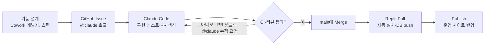

# 공동 개발자 온보딩 — Claude 개발 환경 안내

이 문서대로 PC를 준비하고, Claude Code로 기능을 구현해 PR을 올리는 데까지가 공동 개발자의 역할입니다. 운영 배포는 `main` 브랜치 기준으로 배포 담당자가 Replit에서 진행합니다.

## 개요

- **프로젝트:** Manufacturing Synergy Hub — 베트남 제조 협력 B2B 포털 (한국어 UI)
- **기술 스택:** pnpm 모노레포, Node 24, TypeScript, Express 5, React 19 + Vite, Tailwind, Drizzle + PostgreSQL, Clerk 인증
- **운영 사이트:** https://coselling.infoerp.com.vn
- **소스 기준:** GitHub `main` 브랜치 (Replit은 배포 대상)



스펙을 쓰고 Issue에서 `@claude`를 부르면 Claude Code가 PR까지 만들고, CI와 리뷰를 통과해야만 `main`에 들어갑니다. 로컬(데스크톱 Code 탭)에서 작업해도 같은 PR 흐름을 따릅니다. Replit 단계(Pull·Publish)는 배포 담당자가 맡습니다.

## 1. 준비물 체크리스트

시작 전에 아래 항목을 모두 갖추세요. 비밀값(키·비밀번호)은 채팅이나 이메일 본문이 아니라 사내 비밀 공유 채널로만 전달받습니다.

| 항목 | 내용 | 누가 준비 |
| --- | --- | --- |
| GitHub 계정 | 이 저장소에 **Write** 권한 협업자로 초대 수락 | 관리자 초대 → 본인 수락 |
| Claude 구독 | 본인 명의 Claude Pro/Max(또는 Team) 계정 — Claude Code와 데스크톱 앱 사용 | 본인 |
| Git | Git for Windows 최신 버전 | 본인 설치 |
| Node.js | **v24** (LTS) | 본인 설치 |
| pnpm | **v10** (`npm install -g pnpm@10`) | 본인 설치 |
| PostgreSQL | **v16**, 로컬 DB `synergy` 생성 | 본인 설치 |
| `.env` 값 | `DATABASE_URL`(본인 로컬 DB), Clerk **개발용(DEV)** 키 3개: `CLERK_SECRET_KEY`, `CLERK_PUBLISHABLE_KEY`, `VITE_CLERK_PUBLISHABLE_KEY` | 관리자가 안전하게 전달 |
| (선택) Gemini 키 | 뉴스·행사·공고 AI 수집 기능을 로컬에서 시험할 때만 | 관리자 |
| Replit 접근 | **배포 담당자만** 팀 워크스페이스 초대 | 관리자 |

먼저 읽을 문서 (저장소 안):

- [`CLAUDE.md`](CLAUDE.md) — Claude Code가 따르는 작업 규칙 (사람도 꼭 읽기)
- [`replit.md`](replit.md) — 전체 구조, 기능, 배포 방식
- [`artifacts/api-server/AUTHENTICATION.md`](artifacts/api-server/AUTHENTICATION.md) — Clerk 인증·권한 정책
- [`docs/specs/README.md`](docs/specs/README.md) — 기능 스펙 작성 방법과 템플릿

운영(Production) Clerk 키, Replit Secrets, GitHub 관리자 토큰은 공동 개발자에게 전달하지 않습니다.

## 2. PC 개발 환경 설치 (Windows)

아래 순서대로 PowerShell에서 실행하면 로컬 포털이 http://localhost:5173 에 뜹니다. 작업 폴더는 OneDrive 동기화 폴더가 아닌 곳(예: `C:\dev`)을 쓰세요.

1. pnpm 설치

   ```powershell
   npm install -g pnpm@10
   ```

2. 로컬 DB 생성 (PostgreSQL 16 설치 후)

   ```powershell
   createdb -U postgres synergy
   ```

3. 저장소 복제

   ```powershell
   cd C:\dev
   git clone https://github.com/microweb77-max/Manufacturing-Synergy-Hub.git
   cd Manufacturing-Synergy-Hub
   ```

4. 환경 변수 파일 만들기 — `.env`를 열어 전달받은 값을 넣습니다.

   ```powershell
   copy .env.example .env
   notepad .env
   ```

   ```
   DATABASE_URL=postgres://postgres:<로컬비밀번호>@localhost:5432/synergy
   CLERK_SECRET_KEY=sk_test_...
   CLERK_PUBLISHABLE_KEY=pk_test_...
   VITE_CLERK_PUBLISHABLE_KEY=pk_test_...
   ```

5. 의존성 설치 → DB 테이블 생성 → 실행

   ```powershell
   pnpm install
   pnpm run db:push:local
   pnpm run dev:local
   ```

6. 브라우저에서 http://localhost:5173 을 열고 로그인까지 확인합니다. API 서버는 8080번 포트에서 함께 뜹니다 (`/api`는 Vite가 프록시).

macOS도 같은 순서이며, `copy` 대신 `cp`, `notepad` 대신 원하는 편집기를 씁니다.

설치 중 자주 만나는 문제:

| 증상 | 해결 |
| --- | --- |
| `pnpm` 실행 시 "스크립트를 실행할 수 없습니다" | `Set-ExecutionPolicy -Scope CurrentUser RemoteSigned` 실행 후 PowerShell 재시작 |
| `createdb`를 찾을 수 없음 | `C:\Program Files\PostgreSQL\16\bin`을 PATH에 추가하거나 pgAdmin에서 DB 생성 |
| 폴더가 두 번 중첩됨 (`...Hub\Manufacturing-Synergy-Hub`) | 상위 폴더에서 clone했는지 확인, `package.json`이 있는 폴더에서 명령 실행 |
| 로그인 화면이 안 뜨거나 Clerk 오류 | `.env`의 Clerk 키 3개가 모두 DEV(`pk_test_`/`sk_test_`)인지 확인 |
| 포트 충돌 | 다른 개발 서버를 끄거나 `.env`에 `API_PORT`·`WEB_PORT` 지정 |

## 3. Claude Code 사용법 3가지

기능 단위 개발은 ① GitHub Issue 방식을 기본으로, 화면을 보며 다듬는 작업은 ② 데스크톱 방식을 씁니다.

| 방식 | 어디서 실행 | 누구 구독으로 동작 | 적합한 작업 |
| --- | --- | --- | --- |
| ① GitHub Issue `@claude` | GitHub Actions(클라우드) | 저장소 소유자 토큰 | 스펙이 있는 기능 구현, 버그 수정 |
| ② 데스크톱 앱 Code 탭 | 내 PC (로컬 폴더) | 본인 | UI 확인하며 반복 수정, 디버깅 |
| ③ claude.ai/code | Anthropic 클라우드 | 본인 | PC 없이 작업, 긴 작업 맡기기 |

### ① GitHub Issue에서 @claude 호출

1. Issue를 만들 때 템플릿 **Feature spec**을 고르거나, `docs/specs/`의 스펙 파일 경로를 적습니다.
2. 본문이나 댓글에 `@claude`를 적거나 `claude` 라벨을 붙입니다.
3. Claude가 브랜치를 만들고 구현·테스트 후 `gh pr create`로 PR을 엽니다 (보통 10~30분).
4. PR에 CI(typecheck·build·test)가 돌고, 리뷰어가 확인합니다.
5. 고칠 점은 PR 댓글에 `@claude`로 요청합니다.

요청 예시:

```
@claude docs/specs/004-xxx.md 스펙대로 구현해주세요.
CLAUDE.md 규칙을 따르고, 테스트를 추가한 뒤 PR을 열어주세요.
```

### ② 데스크톱 앱 Code 탭

1. Claude 데스크톱 앱 → **Code** 탭 → 로컬 저장소 폴더를 엽니다.
2. `.claude/launch.json`에 등록된 `pnpm run dev:local`로 미리보기(포트 5173)를 띄울 수 있습니다.
3. 작업 전 항상 새 브랜치를 만들도록 요청합니다: "`feat/xxx` 브랜치에서 작업하고 PR까지 열어줘".
4. 권한은 `.claude/settings.json`에 정해져 있습니다. `.env` 읽기, `git push --force`, `main` 직접 push는 막혀 있습니다.

### ③ claude.ai/code (웹)

1. https://claude.ai/code 에서 GitHub를 연결하고 이 저장소를 선택합니다.
2. 세션이 시작되면 SessionStart 훅(`scripts/claude-session-start.sh`)이 pnpm과 의존성을 자동 설치합니다.
3. 작업 결과는 브랜치 push → PR로 받습니다.

## 4. 개발 규칙과 보안 수칙

`main` 브랜치가 유일한 기준이며, 모든 변경은 브랜치 → PR → CI 통과 → 리뷰 → Merge로만 `main`에 들어갑니다.

### 개발 규칙

- **`main`에 직접 push 금지.** 새 기능은 `feat/<번호>-<이름>`, 수정은 `fix/...` 브랜치에서 작업합니다. Merge된 브랜치는 다시 쓰지 않습니다.
- **PR은 작게.** 한 PR에 한 기능, 설명은 한국어로 쓰고 `Closes #<Issue번호>`를 넣습니다.
- **스펙 먼저.** 새 기능은 `docs/specs/_template.md`를 복사해 스펙을 쓴 뒤 구현합니다. API 표에는 모든 필터·파라미터를 빠짐없이 적습니다.
- **API는 OpenAPI가 원본.** `lib/api-spec/openapi.yaml`을 먼저 고치고 codegen으로 `lib/api-client-react`, `lib/api-zod`를 재생성합니다. 생성된 파일을 손으로 고치지 않습니다.
- **DB는 추가만.** 테이블·컬럼 추가는 되지만 삭제·이름 변경은 하지 않습니다 (Replit Pull 시 `db push`가 자동 실행되기 때문).
- **권한은 한 곳에서.** 새 API의 공개/로그인/관리자 여부는 `middlewares/apiAuthorization.ts`에 등록합니다. 비공개 필드는 서버에서 제거해 내려보냅니다.
- **응답 형식.** 라우트 응답은 `toJson()`으로 감싼 뒤 Zod `.parse()`를 거칩니다.
- **UI는 한국어,** 모바일 화면까지 확인합니다.
- **테스트 추가.** API 변경에는 `artifacts/api-server/tests/`에 테스트를 넣고, PR 전에 아래 세 가지를 통과시킵니다.

  ```powershell
  pnpm run typecheck
  pnpm -r --if-present run build
  pnpm test
  ```

- **문서 갱신.** 구조나 기능이 바뀌면 `replit.md`와 해당 스펙을 함께 고칩니다.

### 보안 수칙

- 비밀값(API 키, 비밀번호, 토큰)을 채팅·Issue·PR·커밋에 적지 않습니다. Claude에게도 붙여넣지 않습니다.
- `.env`는 커밋하지 않습니다 (`.gitignore`에 포함). 새 환경 변수는 `.env.example`에 이름만 추가합니다.
- 로컬에서는 Clerk **개발용 키만** 씁니다. 운영 키는 Replit Secrets에만 있습니다.
- 개인정보(회원 명단, 연락처가 담긴 엑셀 등)는 저장소에 올리지 않습니다. 테스트에는 가상 데이터를 씁니다.
- 다른 사람의 개인 액세스 토큰(PAT)을 빌려 쓰지 않고, 필요하면 본인 토큰을 최소 권한으로 만듭니다.

## 5. 배포 절차와 문제 해결

배포는 배포 담당자가 `main`이 업데이트된 뒤 Replit에서 Pull → Publish로만 합니다. 공동 개발자는 PR을 `main`에 Merge하는 데까지만 책임집니다.

### 배포 순서 (배포 담당자)

1. Replit 팀 워크스페이스의 프로젝트를 엽니다.
2. Shell에서 현재 브랜치가 `main`인지 확인하고 가져옵니다: `git fetch && git pull --ff-only`.
3. Pull 후 `scripts/post-merge.sh`가 자동으로 `pnpm install --frozen-lockfile`과 DB push를 실행합니다.
4. Deployments 패널에서 **Publish**를 누릅니다.
5. 운영 사이트에서 변경 기능을 확인합니다: https://coselling.infoerp.com.vn

Replit Agent로 수정할 때도 새 브랜치 → GitHub PR → `main` 순서를 지킵니다. Replit에서 `main`에 바로 커밋하지 않습니다.

### 자동 수집 작업 (주간)

행사·공고 AI 수집과 알림 메일은 아래 엔드포인트를 예약 실행해 돌립니다. 헤더는 `Authorization: Bearer <NEWS_SCHEDULER_TOKEN>`입니다 (토큰은 Replit Secrets에만 보관).

| 엔드포인트 | 하는 일 |
| --- | --- |
| `POST /api/scheduled/events-collect` | 베트남 제조·AI 행사/전시회/세미나 수집 |
| `POST /api/scheduled/tenders-collect` | 정부·주요 발주처 공고 수집 |
| `POST /api/scheduled/weekly-alerts` | 북마크·관심 알림 주간 메일 발송 |

### 알아두면 좋은 주의점

| 상황 | 원인과 대응 |
| --- | --- |
| Claude가 `.github/workflows/` 변경을 push 못 함 | GitHub App 권한 제한. 워크플로 파일은 사람이 직접 커밋 |
| Claude가 push한 커밋에 CI가 안 돎 | 봇 push는 CI를 시작하지 않음. 본인 계정으로 빈 커밋(`git commit --allow-empty -m "ci: rerun"`) push |
| GitHub `@claude` 사용량 | 저장소 소유자의 구독 토큰(`CLAUDE_CODE_OAUTH_TOKEN`)으로 동작. 필요한 만큼만 호출 |
| Merge 후 추가 커밋이 누락됨 | Merge 전에 모든 push가 PR에 반영됐는지 확인. 이후 작업은 새 브랜치로 |
| 로컬 PostgreSQL이 멈춤 | Windows 서비스(services.msc)에서 `postgresql-x64-16` 재시작 |
| Replit Git 패널 숫자가 이상함 | 패널 대신 Shell에서 `git fetch` 후 `git status`로 확인 |

### 참고 문서와 링크

- 저장소 문서: [`CLAUDE.md`](CLAUDE.md), [`replit.md`](replit.md), [`artifacts/api-server/AUTHENTICATION.md`](artifacts/api-server/AUTHENTICATION.md), [`docs/specs/README.md`](docs/specs/README.md)
- 완료된 스펙 예시: [`docs/specs/002-events.md`](docs/specs/002-events.md)(행사·전시회), [`docs/specs/003-tenders.md`](docs/specs/003-tenders.md)(사업 공고)
- Claude Code 공식 문서: https://docs.claude.com/en/docs/claude-code/overview
